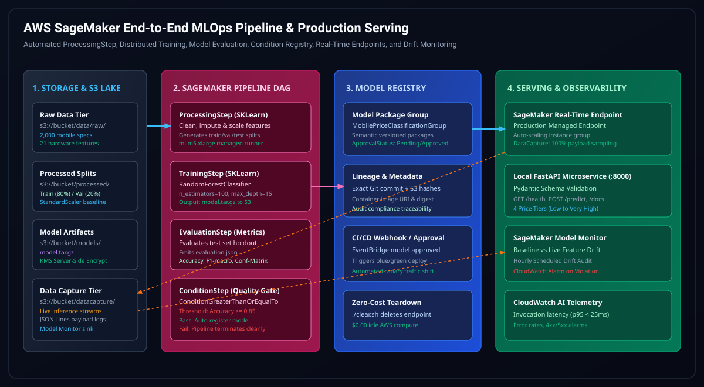
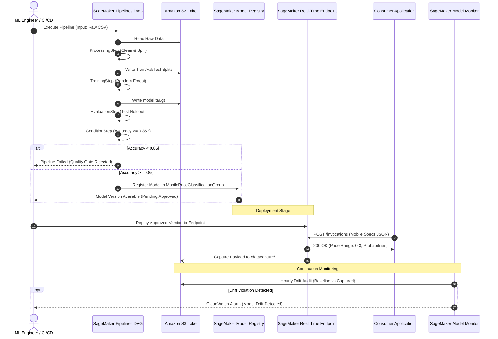

# 🏛️ AWS SageMaker End-to-End MLOps Platform Architecture

> **Enterprise Machine Learning Architecture featuring Automated SageMaker Pipelines DAG, Model Registry Governance, Real-Time Endpoints, and Production Drift Monitoring.**



---

## 📑 Architectural Blueprint & Overview

The **AWS SageMaker MLOps Platform** automates the complete model lifecycle for enterprise mobile hardware price tier classification. The architecture guarantees end-to-end reproducibility through managed compute runners (`SKLearnProcessor`), automated quality gating (`ConditionStep`), immutable model registry packages, live payload data capture, and continuous drift monitoring.

```
+-----------------------------------------------------------------------------------+
|                        AWS SAGEMAKER PIPELINES DAG                                |
|                                                                                   |
|  [S3 Raw Data]                                                                    |
|       |                                                                           |
|       v                                                                           |
|  +----------------+      +----------------+      +----------------+               |
|  | ProcessingStep | ---> |  TrainingStep  | ---> | EvaluationStep |               |
|  | (SKLearn clean)|      | (Random Forest)|      | (Metric JSON)  |               |
|  +----------------+      +----------------+      +----------------+               |
|                                                          |                        |
|                                                          v                        |
|                                                  +----------------+               |
|                                                  | ConditionStep  |               |
|                                                  | (Acc >= 0.85)  |               |
|                                                  +----------------+               |
|                                                          |                        |
|                                                          v (Pass)                 |
|                                                  +----------------+               |
|                                                  | ModelStep      |               |
|                                                  | (Registry)     |               |
|                                                  +----------------+               |
+----------------------------------------------------------|------------------------+
                                                           v
+-------------------------------+               +-----------------------------------+
| Live SageMaker Endpoint /     | <-----------  | Model Package Approval &          |
| Local FastAPI Serving (:8000) |               | EventBridge CI/CD Trigger         |
+-------------------------------+               +-----------------------------------+
                |                                                 |
                v (Data Capture)                                  v
+-------------------------------+               +-----------------------------------+
| S3 Inference Data Capture     | ------------> | SageMaker Model Monitor &         |
| s3://bucket/datacapture/      |               | CloudWatch Drift Telemetry        |
+-------------------------------+               +-----------------------------------+
```

---

## 🧩 Enterprise AI Architect Roadmap (Phases 0 – 5)

### Phase 0: Base Service Foundation & SLO Design
- **Local Simulation API**: FastAPI microservice (`src/api/main.py`) mirroring the SageMaker production inference interface.
- **Contract Strictness**: Pydantic schemas validating all 21 hardware features (battery_power, blue, clock_speed, dual_sim, fc, four_g, int_memory, m_dep, mobile_wt, n_cores, pc, px_height, px_width, ram, sc_h, sc_w, talk_time, three_g, touch_screen, wifi).
- **Latency SLOs**:
  - `p50 Latency`: $\le 12\text{ms}$
  - `p95 Latency`: $\le 25\text{ms}$
  - `p99 Latency`: $\le 50\text{ms}$
- **Telemetry Endpoints**: `/health` verifying model readiness, feature count, and class maps; interactive Swagger docs at `/docs`.

### Phase 1: Core Machine Learning Engine
- **Task**: Multi-class classification across 4 mobile price tiers:
  - `0`: Low Cost
  - `1`: Medium Cost
  - `2`: High Cost
  - `3`: Very High Cost
- **Algorithm**: `RandomForestClassifier` with balanced sub-sampling, tuned across 100 estimators, max depth 15.
- **Evaluation Gate**: Condition threshold enforcing accuracy $\ge 0.85$ on holdout test set before registry promotion.

### Phase 2: SageMaker Pipelines DAG & Lakehouse MLOps
- **Orchestration**: Fully managed DAG compiled via SageMaker Python SDK (`Pipeline`, `ProcessingStep`, `TrainingStep`, `ModelStep`).
- **Data Lake Layout**:
  - Raw Ingestion: `s3://bucket/data/raw/`
  - Preprocessed Splits: `s3://bucket/processed/`
  - Model Binaries: `s3://bucket/models/model.tar.gz`
  - Evaluation Reports: `s3://bucket/evaluation/evaluation.json`
- **Model Registry**: Centralized catalog (`MobilePriceClassificationGroup`) storing exact lineage, Git commits, container digests, and approval states.

### Phase 3: Drift Detection & Automated Governance
- **Data Capture**: 100% sampling of inference inputs and outputs written to `s3://bucket/datacapture/`.
- **SageMaker Model Monitor**: Scheduled baseline statistics computation comparing live production distributions against training baseline.
- **Drift Alerting**: CloudWatch alarm triggered on statistical divergence, alerting MLOps on-call and invoking pipeline retraining.

### Phase 4: Scalable Cloud Inference & Resilience
- **Serving Topologies**:
  - AWS Managed Real-Time Endpoint: Auto-scaling instance groups behind AWS PrivateLink.
  - Local Container: Standalone lightweight Docker Compose runner on port `8000` for offline validation.
- **Security Posture**: AWS KMS server-side encryption across all S3 buckets, least-privilege IAM execution roles, zero public bucket policies.

### Phase 5: FinOps, Lineage & Teardown
- **Zero-Cost Teardown**: Idempotent `./clear.sh` cleaning 100% of local processes and orphan containers for **$0.00 idle spend**.
- **Governance Audit**: Full lineage tracking from raw S3 CSV hash to deployed endpoint ARN.

---

## 🔄 End-to-End Inference & Pipeline Sequence Flow



---

## ⚡ Deployment & Verification

| Mode | Command | Target Runtime |
| :--- | :--- | :--- |
| **Zero-Touch Cloud Bootstrap** | `curl -fsSL https://raw.githubusercontent.com/KishorKumarParoi/Aws-Sagemaker/main/bootstrap.sh \| bash` | Bare EC2 / Cloud VM |
| **Local Standalone Serving** | `./deploy.sh --standalone` | Local (<15s) |
| **Containerized Serving** | `./deploy.sh` | Docker Compose (`:8000`) |
| **Zero-Cost Teardown ($0.00)** | `./clear.sh` | Clean compute |
